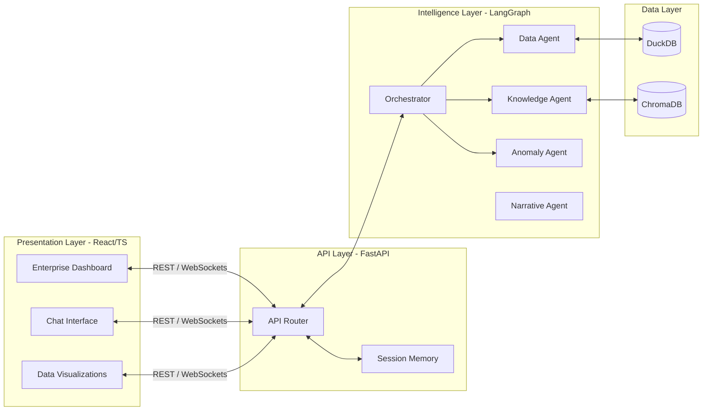
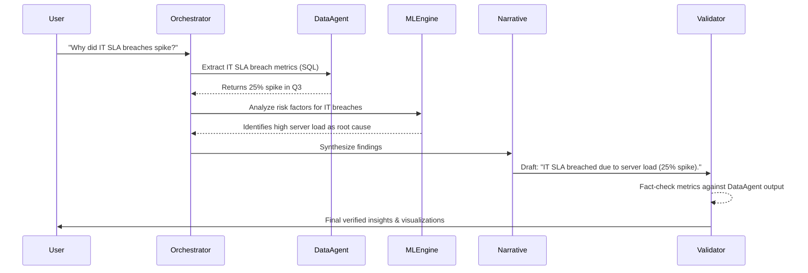
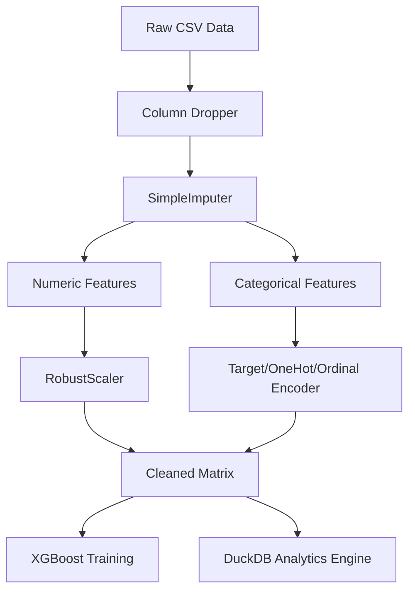

# 🏛️ Multi-Agent Enterprise Architecture

## 1. High-Level System Design

The architecture is divided into three primary tiers: the React Frontend, the FastAPI Backend, and the LangGraph Multi-Agent Orchestration layer.

## 2. The Multi-Agent Workflow

Our state machine guarantees that LLMs are used strictly for **reasoning and synthesis**, while hard mathematics and data extraction are handled by **deterministic engines** (DuckDB, Pandas, XGBoost).

## 3. Data & ML Pipeline (Phases 1-2)

The system relies on a strictly defined data engineering pipeline to ensure the ML models and data agents have clean, normalized data before analytics begin.

## 4. Key Architectural Principles
- **Zero LLM Math:** All quantitative aggregations occur in DuckDB.
- **Auditability:** Every agent action is logged and tracked in the `Session Memory`.
- **Stateless AI, Stateful Backend:** The agents are stateless functions; context is injected dynamically per turn by the FastAPI backend.
