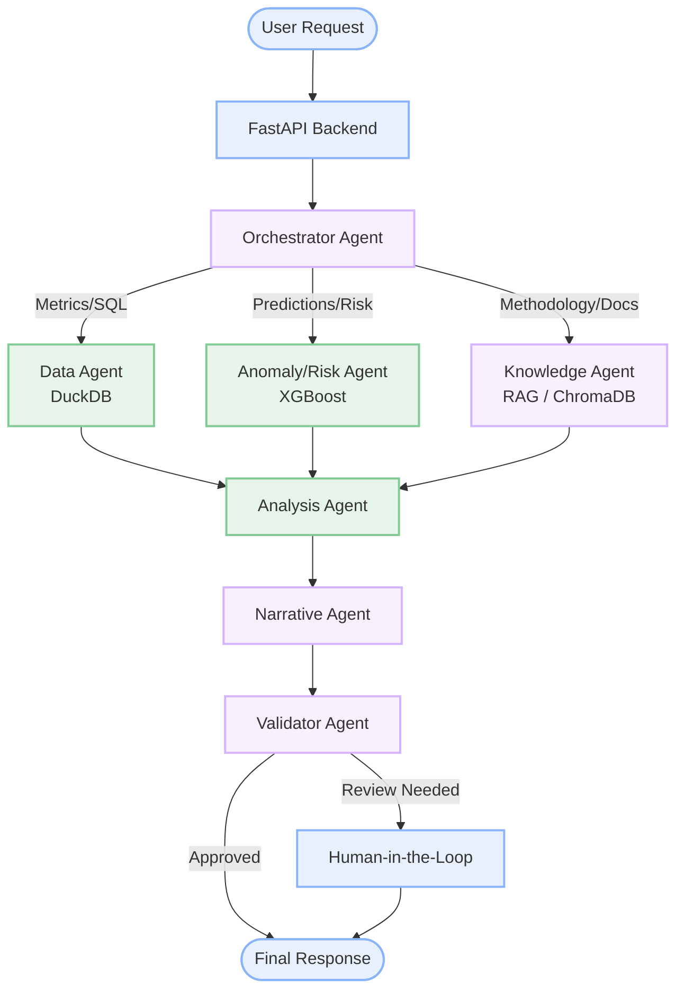
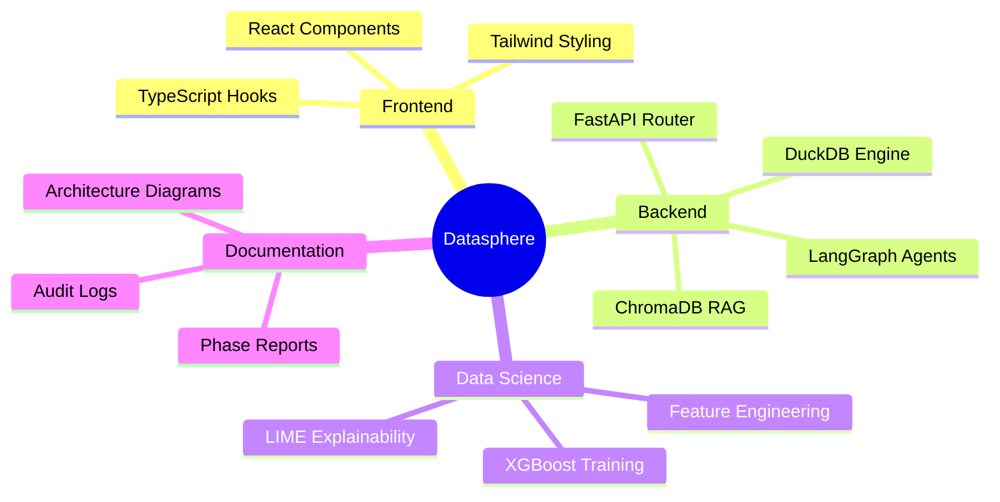

# 🌐 Datasphere: Multi-Agent Data Analyst for Enterprise Decision Support

> **DATASPHERE 26 · Track 06 — Generative AI & Agentic AI**
>
> An intelligent multi-agent system that understands natural language business questions, retrieves and analyzes enterprise AI operations data, generates visualizations, and provides explainable, actionable insights — all without requiring technical expertise from the user.

---

## 🎯 Overview

The **Multi-Agent Data Analyst** is an enterprise-grade platform designed to democratize data analytics. It translates natural language questions into deterministic SQL queries, leverages machine learning (XGBoost) for anomaly detection, and uses LLMs solely for orchestrating tasks and synthesizing human-readable narratives.

### Key Capabilities
- **NL-to-SQL:** Converts business questions to precise DuckDB queries.
- **Predictive Risk Modeling:** XGBoost models detect anomalies and predict SLA breaches.
- **Explainable AI:** Generates LIME visualizations to explain machine learning predictions.
- **Memory & Context:** Remembers past conversational context and user preferences across sessions.
- **No Hallucinations:** Numbers are derived purely from code and deterministic data engines, never from the LLMs themselves.

---

## 🏗️ System Architecture

The core orchestration relies on a **LangGraph state graph** where specialized AI agents collaborate to fulfill enterprise requests.



*(Purple nodes utilize LLMs; Green nodes are deterministic data/ML engines)*

---

## 🛠️ Technology Stack

| Layer | Technology |
|---|---|
| **Frontend** | React, TypeScript, Tailwind CSS, Vite |
| **Backend API** | FastAPI (Python 3.11+) |
| **Orchestration** | LangGraph, LangChain |
| **LLM Inference** | Groq (Llama 3.1 70B), Ollama (Local Models) |
| **Vector Database** | ChromaDB (BM25 Hybrid Search) |
| **Data Engine** | DuckDB, Pandas |
| **Machine Learning** | XGBoost, Scikit-Learn |
| **Explainability** | LIME (Local Interpretable Model-agnostic Explanations) |

---

## 📂 Project Structure



---

## 🚀 Getting Started

### Prerequisites
- Python 3.11+
- Node.js 18+
- [Ollama](https://ollama.ai/) with `gemma3:12b` or `deepseek-r1` (Optional for local LLM usage)
- Groq API key ([console.groq.com](https://console.groq.com))

### 1. Backend Setup (FastAPI + LangGraph)
```bash
cd backend
python -m venv venv312
# Windows
venv312\Scripts\activate
# Mac/Linux
source venv312/bin/activate

pip install -r requirements.txt
cp .env.example .env # Configure your GROQ_API_KEY
python main.py
```

### 2. Frontend Setup (React)
```bash
cd frontend
npm install
npm run dev
```

---

## 📈 Dataset Details

**Enterprise Multi-Agent Decision Support Log** — 200,000 rows tracking AI agent performance across 7 departments.
- **37 columns** covering operations, KPIs, financials, and risk metrics.
- **7 AI Agents Tracked:** Finance, ITOps, Marketing, SupplyChain, Sales, HR, CustomerService.
- **Target Variable:** `SLA_Breached` (Binary classification for anomaly detection).

---

## 🤝 Contributing & License

Developed for the **DATASPHERE 26** Datathon competition. See `docs/` and `phase6/` for full audit reports, certification checklists, and architectural decisions.
