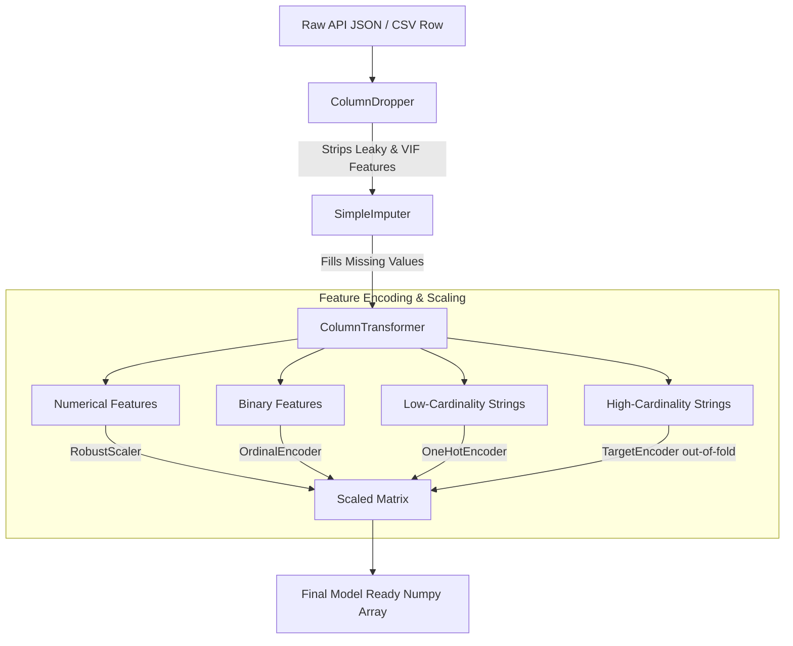

# Phase 1: Architecture

## Preprocessing Pipeline Architecture

The data preparation phase strictly adheres to a modular, sequential scikit-learn `Pipeline` architecture to ensure no data leakage and perfect reproducibility.

### Key Components

1. **`ColumnDropper`:** A custom `TransformerMixin` injected at step 1. It dynamically intercepts the raw DataFrame and excises specific columns known to cause leakage (`Decision_Outcome`), perfect collinearity (`Total_Tokens`), or high VIF variance (`Year`, `Quarter`).
2. **`ColumnTransformer`:** The core routing engine. It scans the remaining feature types and routes them mathematically.
3. **`TargetEncoder`:** Converts high-cardinality strings into dense, smoothed numerical probabilities of `SLA_Breached`.
4. **`RobustScaler`:** Anchors extreme enterprise KPIs using median/IQR instead of mean/standard deviation.
