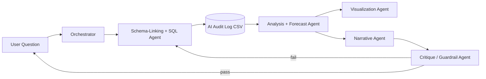

# MERIDIAN-MVP — Multi-Agent Data Analyst
### Buildable MVP Plan (Hybrid Stack, Large-Scale Dataset)

*Companion to the Enterprise document. This one is meant to actually get built — every section maps to something you run, not just design.*

---

## 1. MVP Philosophy — What's Cut, What's Kept

The enterprise document describes 12 agents, three graphs, full A2A interoperability, and audit-grade governance. None of that is buildable solo in a reasonable timeframe, and none of it is what a demo needs to be *impressive*. The MVP keeps the parts that make the architecture legible and the demo strong, and cuts everything that's enterprise-governance overhead:

**Kept:** governed semantic layer (lightweight), a real multi-agent pipeline with a verification step, a genuinely large dataset, hybrid local+API model routing, forecasting, and full explainability in the UI (SQL + confidence shown, not hidden).

**Cut for MVP:** the ontology/lineage graph pair (one lightweight metadata layer instead of three graphs), A2A cross-vendor interoperability, RBAC/ABAC at enterprise depth (a simplified role-check stands in), and the 12-agent roster (collapsed to 6 — §4).

---

## 2. Dataset Strategy — Going "Huge" On Purpose

Since the scale of the dataset is your headline differentiator, pick a dataset where "huge" is *architecturally meaningful*, not just a big CSV.

### Primary recommendation: The AI System Audit Log

The actual dataset provided for this track is a 200,000-row flat file (`enterprise_multiagent_decision_support.csv`). This is a **Multi-Agent System Audit Log**. Instead of traditional retail sales, it tracks the real-time operational decisions, token efficiency, anomalies, and human escalations of an entire AI workforce.

| Property | Detail |
|---|---|
| Schema style | Single, wide flat-file table (37 columns) tracking agent execution metrics. |
| Scale factor → size | 200,000 rows, ~83 MB. This is statistically significant enough to demonstrate ML on an agent's latency and token usage patterns. |
| Realism | Captures real-world AI deployment friction: SLA breaches, false confidence, human-in-the-loop bottlenecks, and computational token costs. |
| Where to load it | DuckDB or Pandas directly. Because it is a flat file, we don't need complex Snowflake schemas or 6-way joins. The focus moves from "data modeling" to "insight extraction." |

**Recommendation:** Go all-in on this dataset. It allows you to build an incredibly modern **"Meta-AI System"** (an AI that analyzes other AIs). This guarantees strict alignment with the datathon's problem statement and avoids the massive overhead of managing a fake retail database.

---

## 3. Tech Stack — Hybrid (Local + Paid API)

You already run this pattern successfully in ARIA-OS (15 concurrent async agents on local Ollama/Mistral 7B, FastAPI + Next.js, PostgreSQL). The MVP reuses that exact backbone and only adds a paid-API tier for the two roles where it actually earns its cost.

| Layer | Choice | Why |
|---|---|---|
| Orchestration | **LangGraph** | Matches the Enterprise doc's recommendation (checkpointing, durable state) and is a natural evolution from the async orchestration you already built for ARIA-OS |
| Local model tier | **Ollama, Mistral-class 7B (or a SQL-specialized fine-tune, e.g. OmniSQL-7B from Hugging Face)** | Free, fast, no API cost — use for Orchestrator, Schema-Linking, Visualization, and first-pass SQL generation |
| Paid API tier | **One frontier model (Claude or GPT) for Narrative synthesis and the Critique/Verifier agent only** | These are the two roles where output quality is most visible to a judge/user and where "different vendor than the generator" (§4) meaningfully reduces error — worth the API spend specifically here, nowhere else |
| Backend | **FastAPI** | Same as ARIA-OS — you already have this working |
| Frontend | **Next.js** | Same as ARIA-OS |
| Database (metadata + agent state) | **PostgreSQL** | Same as ARIA-OS's 18-table pattern — reuse the schema-design instincts you already have |
| Analytical warehouse | **DuckDB (embedded)** | DuckDB easily ingests the 200K row CSV in milliseconds.
| Semantic layer (lightweight) | **A YAML/JSON metric-definition file** (name, SQL expression, allowed dimensions) consumed by the Schema-Linking agent | You don't need a full Cube/dbt Semantic Layer deployment for MVP — a governed metrics file that agents must consult is the same architectural principle at 5% of the setup cost |

**Cost-routing rule of thumb:** anything that runs on every single query (routing, schema linking, chart-spec generation) stays local and free. Anything that runs once per answer and materially affects perceived quality (the final narrative, the pass/fail verification) goes to the paid tier.

---

## 4. Simplified Agent Architecture



| # | Agent | Model tier | Collapses which Enterprise-doc agents |
|---|---|---|---|
| 1 | Orchestrator | Local | Orchestrator/Router |
| 2 | Schema-Linking + SQL | Local (SQL-specialized) | Clarification + Schema-Linking + Text-to-SQL |
| 3 | Analysis + Forecast | Local + code-execution sandbox | Statistical Analysis |
| 4 | Visualization | Local | Visualization |
| 5 | Narrative | **Paid API** | Narrative Synthesis + Recommendation |
| 6 | Critique / Guardrail | **Paid API (different vendor than #2/#5)** | Critique/Verifier + Guardrail/Compliance |

---

## 5. Data Preprocessing Pipeline

1. **Load**: Load the `enterprise_multiagent_decision_support.csv` flat file directly into DuckDB.
2. **Clean/validate**: Handle the intentional nulls (e.g., fill `Agent_Accuracy_Feedback` with 0, and `Employee_ID_Handler` with 'Auto-Resolved' since not all queries hit a human).
3. **Format**: Convert text dates (`Timestamp`, `Transaction_Date`) to proper datetime objects for time-series analysis.
4. **Define metrics**: Write the lightweight semantic YAML (§3) focusing on AI metrics (Token Efficiency, Cost Savings Potential, Escalation Rate).
5. **Cache**: Add a semantic cache keyed on (metric + dimension + filter) so repeated demo questions don't re-hit the warehouse.

---

## 6. ML / Predictive Model Component

To satisfy the "Machine Learning / AI Model" deliverable as a real model artifact (not just LLM prompting):

- **Classification Model**: An XGBoost/LightGBM model predicting `Requires_Human_Review` or `SLA_Breached`. Features include `Input_Tokens`, `Query_Complexity_Score`, and `Processing_Time_Sec`. This predicts whether an AI agent is going to fail and require a human bottleneck.
- **Forecasting Model**: A time-series model (Prophet) forecasting the `Cost_Savings_Potential_USD` generated by AI automation over the next quarter.
- Both models are called **as tools** by the Analysis/Forecast agent (§9 of the Enterprise doc's "tools = superpowers" principle).

---

## 7. Evaluation & Testing Plan (Lightweight)

- Build a **golden Q&A set of ~40-60 questions** against your actual AI Audit Log schema (easy/medium/hard, following the same difficulty tiering GAIA and BIRD use) — this is your real accuracy metric, not a borrowed leaderboard number, matching the Enterprise doc's explicit warning that published Spider/BIRD numbers overstate real-world accuracy
- Use **DeepEval** (free, pytest-style) to run this golden set in CI on every agent/prompt change
- Track: SQL execution accuracy, groundedness of the narrative (every sentence traces to a retrieved number), and end-to-end latency
- Report these numbers explicitly in your submission — "we measured X% accuracy on our own 50-question golden set, not a public leaderboard" is a stronger, more credible claim to judges than an unqualified accuracy percentage

---

## 8. Guardrails (Lightweight)

- Read-only database role for every agent — no write/delete access, full stop
- Row-limit and query-timeout ceiling on every generated SQL query
- Simple PII-pattern check (regex/classifier) before any result reaches the Narrative agent — the AI Audit Log contains sensitive internal SLA and performance scores, demonstrating a real compliance need.
- Critique agent explicitly rejects any narrative sentence that isn't traceable to a retrieved value

---

## 9. Dashboard / Visualization

Next.js frontend showing, for every answer: the natural-language question, the generated SQL (collapsible), the chart, the narrative, and a confidence badge from the Critique agent. This "show your work" surface *is* your explainability deliverable — don't bury it in a separate technical-documentation-only appendix.

---

## 10. Repo Structure (Source Code Deliverable)

```
meridian-mvp/
├── backend/
│   ├── agents/           # one module per agent (§4)
│   ├── orchestration/    # LangGraph graph definition
│   ├── semantic/         # metric YAML + schema-linking logic
│   ├── models/           # forecasting + anomaly detection artifacts
│   ├── db/                # DuckDB connection, AI Audit Log views
│   └── main.py             # FastAPI entrypoint
├── frontend/               # Next.js app
├── data/
│   ├── raw/                # enterprise_multiagent_decision_support.csv
│   └── loaders/            # load + validate scripts
├── eval/
│   ├── golden_qa.jsonl     # your 40-60 question golden set
│   └── deepeval_suite.py
├── docs/                    # technical documentation deliverable
└── README.md
```

---

## 11. Technical Documentation Plan

One README-driven document covering: architecture diagram (reuse §4's mermaid diagram), setup instructions, the metric definitions you governed, your golden-set evaluation results, and a short "what we'd build next" section pointing at the Enterprise document's V1/V2 roadmap — this is a strong, low-effort way to show you scoped a real enterprise vision without over-claiming you built it.

---

## 12. Presentation (PPT) Outline

1. Problem — analysts are the bottleneck between a question and a trustworthy answer
2. Why "just prompt a chatbot" fails at enterprise scale — the trust-boundary problem (Enterprise doc §4)
3. Architecture — the 6-agent pipeline (§4 diagram)
4. The dataset — why analyzing an AI Audit Log is the modern benchmark for decision-support
5. Live demo — 2-3 questions of increasing difficulty, showing SQL + confidence + narrative
6. Evaluation — your golden-set accuracy numbers, honestly reported
7. What's next — pointer to the Enterprise document's full 12-agent, governed-graph vision
8. Close — the one differentiator judges should remember: verification is an agent in the loop, not a hope

---

## 13. Prediction Results Deliverable

Present the forecasting model's output as a concrete artifact: a table/chart of predicted vs. actual SLA breaches and Cost Savings for a held-out period of the AI Audit time series, with error metrics (MAPE/RMSE) — this is your tangible "Prediction Results" deliverable, separate from the conversational Q&A demo.

---

## 14. Build Milestones

| Milestone | Scope |
|---|---|
| **M1 — Data foundation** | Load AI Audit Log CSV, validate, build the view layer, write the first ~10 AI efficiency metric definitions |
| **M2 — Core pipeline** | Orchestrator + Schema-Linking/SQL agent working end-to-end on local models against real data |
| **M3 — Analysis + forecasting** | Train and wire in the forecasting/anomaly models as tools |
| **M4 — Narrative + Critique** | Add the paid-API tier for Narrative and Critique agents; get the verify/retry loop working |
| **M5 — Frontend + explainability surface** | Next.js UI showing SQL/chart/narrative/confidence together |
| **M6 — Evaluation + polish** | Build and run the golden-set eval, fix regressions, write docs, build the deck |

No fixed dates attached since you're not against a hard deadline — treat these as sequential gates, not calendar weeks; each one should be genuinely working before starting the next.

---

## 15. Risks & Mitigations

- **SF=100 feels "big" but can still surprise you on a laptop** — mitigate by testing your view layer/index strategy at SF=10 first, then scaling up once queries are fast
- **Paid API costs on the Narrative/Critique tier can add up during heavy dev iteration** — cache aggressively during development, only hit the paid tier on final-answer calls, not every retry
- **Local 7B models can be inconsistent on complex joins** — this is exactly why the semantic layer's pre-built join views (§5) matter; don't ask the local model to invent 6-way joins from raw tables
