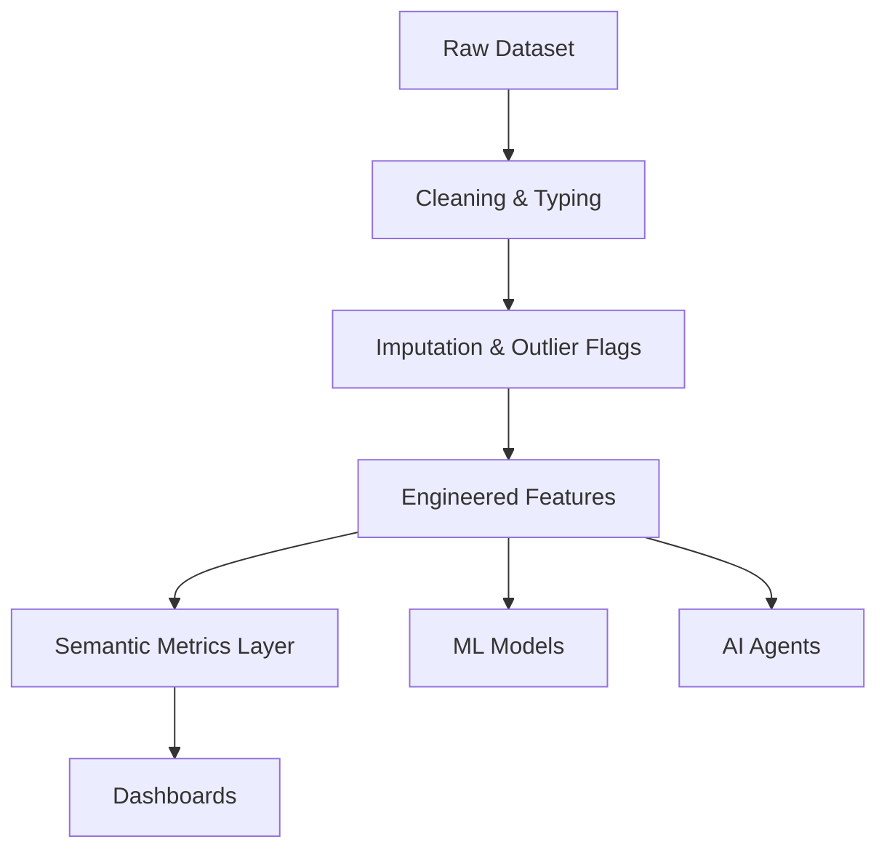
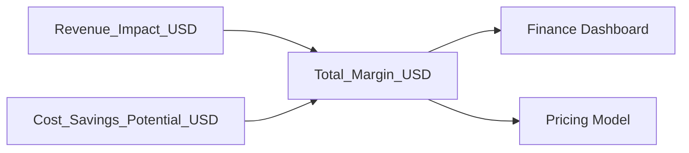
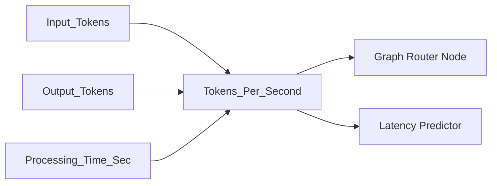
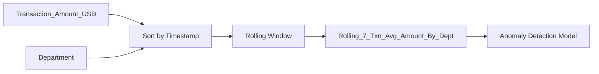

# Feature Lineage

This document traces the complete lineage from raw data ingestion to ML model consumption.

## High-Level Pipeline

## Detailed Feature Traceability

### Business Metrics (`Total_Margin_USD`)

### AI Metrics (`Tokens_Per_Second`)

### Temporal Aggregates (`Rolling_7_Txn_Avg_Amount_By_Dept`)

