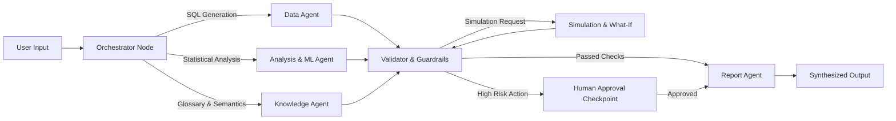

# AI Workspace & Multi-Agent Orchestration Architecture

This document provides an exhaustive breakdown of the **Three-Panel AI Workspace** (`/workspace/ai`), which visually exposes the complete LangGraph multi-agent execution pipeline.

---

## 1. Three-Panel Layout Architecture

```
+-------------------+-----------------------------------+-----------------------------------+
|  Left Panel (20%) |         Center Panel (50%)        |         Right Panel (30%)         |
|  Session History  |  LangGraph Visualizer / Chat Feed | Inspector / Tool Timeline / HITL  |
+-------------------+-----------------------------------+-----------------------------------+
| • Session List    | • Multi-Agent Graph (React Flow)  | • Active Agent Inspector          |
| • Pinned Sessions | • Interactive Agent Nodes & Edges | • Sub-ms Tool Execution Timeline  |
| • Golden Queries  | • Multi-Turn Chat Message Stream  | • Code & SQL Sandbox Viewer       |
| • Agent Statuses  | • Prompt Input Bar with Shortcuts | • Human-in-the-Loop Approval Card |
+-------------------+-----------------------------------+-----------------------------------+
```

---

## 2. Multi-Agent Graph Topology (LangGraph Visualizer)

Built using `@xyflow/react`, the center canvas renders the live state-machine DAG representing the autonomous agent workflow:



### Agent Nodes & Roles:
1. **Orchestrator Agent**: Breaks user analytical intent into discrete tasks, determines sub-graph routing, and monitors execution state.
2. **Data Agent**: Connects to DuckDB, parses schemas, validates joins, and executes deterministic SQL queries.
3. **Analysis Agent**: Executes statistical tests (Shapiro-Wilk, Mann-Whitney, VIF) and trains baseline machine learning models.
4. **Knowledge Agent**: Performs semantic retrieval across ChromaDB vector embeddings and enforces corporate glossary formulas.
5. **Simulation Agent**: Runs Monte Carlo what-if simulations and counterfactual perturbations.
6. **Validator & Guardrails Agent**: Enforces data safety rules, checks for hallucinated columns, and monitors multicollinearity limits.
7. **Report Agent**: Synthesizes multi-agent outputs into formatted executive briefing artifacts.

---

## 3. Human-in-the-Loop (HITL) Safety Checkpoints

When an agent proposes an action with high financial or operational impact, execution pauses and renders [HITLApprovalCard.tsx](file:///c:/PROJECTS/Datasphere/Multi-Agent%20Data%20Analyst%20for%20Enterprise%20Decision%20Support/frontend/src/features/ai/components/HITLApprovalCard.tsx):

* **Trigger Conditions**:
  * Simulated financial intervention $> \$100,000$.
  * Autonomous confidence score $< 85.0\%$.
  * Direct modification of production carrier rate tables.
* **UI Controls**:
  * **Summary of Proposed Action**: Clear explanation of what the agent will execute.
  * **Projected Impact & Risk Level**: Dollar exposure and confidence score.
  * **"Approve & Execute" Button**: Resumes the LangGraph execution path.
  * **"Reject Action" Button**: Routes graph back to the Orchestrator with human feedback.
  * **"Modify Parameters" Input**: Allows the analyst to override specific parameters before execution.

---

## 4. Sub-Millisecond Tool Execution Timeline

Rendered via [ToolExecutionTimeline.tsx](file:///c:/PROJECTS/Datasphere/Multi-Agent%20Data%20Analyst%20for%20Enterprise%20Decision%20Support/frontend/src/features/ai/components/ToolExecutionTimeline.tsx):
* Displays sequential tool calls made by agents (e.g. `duckdb_query_executor`, `shap_tree_explainer`, `vif_calculator`).
* Shows exact execution latency in milliseconds (`42ms`, `118ms`).
* Click-to-inspect parameters, input JSON, and raw output returned by each tool.

---

## 5. Right Inspector & Memory Panel

Rendered via [InspectorPanel.tsx](file:///c:/PROJECTS/Datasphere/Multi-Agent%20Data%20Analyst%20for%20Enterprise%20Decision%20Support/frontend/src/features/ai/components/InspectorPanel.tsx):
* **Active Node Telemetry**: Current agent name, token consumption, and model router (`claude-3-7-sonnet`).
* **Agent Short-Term & Long-Term Memory**: Shows current scratchpad context, session entities, and retrieved semantic snippets.
* **Code & SQL Sandbox Viewer**: Embedded syntax-highlighted code editor previewing executed Python/SQL scripts.

---

## 6. Golden Prompts Modal ([GoldenPromptsModal.tsx](file:///c:/PROJECTS/Datasphere/Multi-Agent%20Data%20Analyst%20for%20Enterprise%20Decision%20Support/frontend/src/features/ai/components/GoldenPromptsModal.tsx))

Pre-configured enterprise queries for live hackathon demonstration:
1. *"Identify the top 3 root causes of Q3 SLA delivery breaches in the Midwest region and quantify revenue leakage."*
2. *"Run an automated multicollinearity audit across all carrier features and simulate model accuracy after dropping high-VIF variables."*
3. *"Generate counterfactual recourse recommendations to recover $1.8M in carrier margin without increasing customer return rates."*
