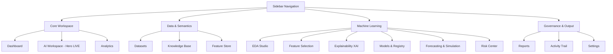

# Sidebar & Navigation Menu Inventory

This document details every navigation item present in the Datasphere Enterprise persistent sidebar ([EnterpriseSidebar.tsx](file:///c:/PROJECTS/Datasphere/Multi-Agent%20Data%20Analyst%20for%20Enterprise%20Decision%20Support/frontend/src/layouts/EnterpriseSidebar.tsx)).

---

## Navigation Sections & Items

---

## Complete Menu Item Specifications

### 1. Dashboard
* **Menu Name**: `Dashboard`
* **Icon**: `LayoutDashboard`
* **Route**: `/workspace/dashboard`
* **Description**: Executive high-level health and performance dashboard.
* **Purpose**: Provide instant visibility into enterprise GMV, gross margin, SLA breaches, operational anomalies, and what-if simulation dials.
* **Business Value**: Enables executives to detect revenue leakage and operational bottlenecks in seconds without manual reporting.
* **Technical Purpose**: Aggregates top-level KPI metrics and anomaly signals via `useDashboardData` React Query hook.
* **Current Status**: ✅ Fully Implemented

### 2. AI Workspace (Hero Menu Item)
* **Menu Name**: `AI Workspace`
* **Badge**: `LIVE` (Cyan pill) + Amber ping indicator for pending human approvals.
* **Icon**: `Bot`
* **Route**: `/workspace/ai`
* **Description**: Three-panel multi-agent analytics console.
* **Purpose**: Orchestrate multi-agent analytical queries, visualize LangGraph execution DAGs in real-time, inspect tool step parameters, and approve/reject critical interventions.
* **Business Value**: Replaces black-box conversational AI with an accountable, step-by-step collaborative agent workspace.
* **Technical Purpose**: Connects to `aiWorkspaceService`, runs React Flow graph layouts, and streams agent thought chains.
* **Current Status**: ✅ Fully Implemented

### 3. Analytics
* **Menu Name**: `Analytics`
* **Icon**: `BarChart3`
* **Route**: `/workspace/analytics`
* **Description**: Operational business intelligence and drill-down analytics.
* **Purpose**: Conduct multidimensional analysis across business units, timeframes, and customer tiers.
* **Business Value**: Uncovers long-term unit economics and regional margin variances.
* **Technical Purpose**: Provides interactive slice-and-dice charting primitives.
* **Current Status**: 🟡 UI Complete (Connected to Analytics View)

### 4. Datasets
* **Menu Name**: `Datasets`
* **Icon**: `Database`
* **Route**: `/workspace/datasets`
* **Description**: Enterprise dataset ingestion and schema explorer.
* **Purpose**: Browse ingested Parquet/DuckDB tables, inspect column data types, missing value percentages, and interactive data lineage DAGs.
* **Business Value**: Guarantees data quality and provides full auditability of underlying data sources.
* **Technical Purpose**: Consumes `dataService.getDatasets()` and renders schema tables and lineage graphs.
* **Current Status**: ✅ Fully Implemented

### 5. Knowledge Base
* **Menu Name**: `Knowledge Base`
* **Icon**: `BookOpen`
* **Route**: `/workspace/knowledge`
* **Description**: Enterprise business glossary and semantic metric definitions.
* **Purpose**: Catalog verified business metrics (e.g. `SLA_Breach_Rate`, `Gross_Margin_Leakage`), SQL formulas, and vector collections.
* **Business Value**: Eliminates semantic drift and guarantees that all AI agents compute metrics using verified corporate formulas.
* **Technical Purpose**: Consumes `dataService.getKnowledgeItems()` with search and tag filtering.
* **Current Status**: ✅ Fully Implemented

### 6. Feature Store
* **Menu Name**: `Feature Store`
* **Icon**: `Boxes`
* **Route**: `/workspace/feature-store`
* **Description**: Centralized ML feature catalog.
* **Purpose**: Manage engineered features, entity primary keys, computation definitions, and feature drift monitors.
* **Business Value**: Prevents feature duplication and avoids training-serving skew in production models.
* **Technical Purpose**: Consumes `dataService.getFeatureStore()` with transformation code inspectors.
* **Current Status**: ✅ Fully Implemented

### 7. EDA Studio
* **Menu Name**: `EDA Studio`
* **Icon**: `PieChart`
* **Route**: `/workspace/eda`
* **Description**: Exploratory Data Analysis & Statistical Studio.
* **Purpose**: Generate univariate histograms, correlation heatmaps, multivariate scatter plots, and hypothesis test verifications.
* **Business Value**: Identifies data quality anomalies, skewness, and non-linear patterns prior to model training.
* **Technical Purpose**: Connects to `edaService` and renders high-performance Apache ECharts visualizations.
* **Current Status**: ✅ Fully Implemented

### 8. Feature Selection
* **Menu Name**: `Feature Selection`
* **Icon**: `Target`
* **Route**: `/workspace/feature-selection`
* **Description**: Multi-method feature ranking and multicollinearity studio.
* **Purpose**: Rank features across Mutual Information, LASSO, Random Forest, and XGBoost, monitor Variance Inflation Factors (VIF), and simulate Top-K subset impact.
* **Business Value**: Reduces model inference latency and prevents overfitting caused by redundant features.
* **Technical Purpose**: Consumes `featureSelectionService` with real-time Top-K subset simulation sliders.
* **Current Status**: ✅ Fully Implemented

### 9. Explainability (XAI)
* **Menu Name**: `Explainability (XAI)`
* **Icon**: `BrainCircuit`
* **Route**: `/workspace/explainability`
* **Description**: Explainable AI and regulatory transparency studio.
* **Purpose**: Visualize global TreeSHAP beeswarm distributions, local waterfall attributions, LIME surrogate models, and counterfactual what-if recourse.
* **Business Value**: Satisfies regulatory compliance (EU AI Act, SR 11-7) and provides actionable customer recourse.
* **Technical Purpose**: Connects to `explainabilityService` with interactive transaction pickers.
* **Current Status**: ✅ Fully Implemented

### 10. Models & Registry
* **Menu Name**: `Models & Registry`
* **Icon**: `Cpu`
* **Route**: `/workspace/models`
* **Description**: Champion vs Challenger model validation center.
* **Purpose**: Compare model performance metrics (ROC-AUC, F1, PR curves, Confusion Matrix), inspect hyperparameters, and test real-time inference payloads.
* **Business Value**: Ensures only thoroughly validated models are promoted to production decision loops.
* **Technical Purpose**: Consumes `modelService` with interactive classification threshold sliders.
* **Current Status**: ✅ Fully Implemented

### 11. Forecasting & Simulation
* **Menu Name**: `Forecasting & Simulation`
* **Icon**: `TrendingUp`
* **Route**: `/workspace/forecasting`
* **Description**: Predictive time-series modeling and scenario simulation.
* **Purpose**: Project SLA breach rates, delivery volume spikes, and seasonal margin fluctuations with uncertainty bands.
* **Business Value**: Enables proactive capacity planning and resource allocation.
* **Technical Purpose**: Time-series charting interface for forecasting algorithms.
* **Current Status**: 🟡 UI Complete (Connected to Forecasting View)

### 12. Risk Center
* **Menu Name**: `Risk Center`
* **Badge**: `142` (Rose pill for high-risk flags)
* **Icon**: `AlertOctagon`
* **Route**: `/workspace/risk`
* **Description**: High-dollar operational risk and SLA breach triage center.
* **Purpose**: Prioritize carrier risk alerts, calculate financial exposure, and assign remediation workflows.
* **Business Value**: Minimizes financial penalties from SLA non-compliance.
* **Technical Purpose**: Risk scoring table and anomaly triage stream.
* **Current Status**: 🟡 UI Complete (Connected to Risk View)

### 13. Reports
* **Menu Name**: `Reports`
* **Icon**: `FileText`
* **Route**: `/workspace/reports`
* **Description**: Executive briefing and boardroom report hub.
* **Purpose**: Browse synthesized multi-agent reports, preview formatted markdown with live KPI cards, and export print-ready PDFs and markdown files.
* **Business Value**: Converts complex multi-agent analysis into digestible boardroom briefings in seconds.
* **Technical Purpose**: Consumes `reportService` with client-side blob generation and print stylesheets.
* **Current Status**: ✅ Fully Implemented

### 14. Activity Trail
* **Menu Name**: `Activity Trail`
* **Icon**: `Activity`
* **Route**: `/workspace/activity`
* **Description**: System execution timeline and agent activity log.
* **Purpose**: Monitor running background tasks, data ingestion syncs, and agent execution times.
* **Business Value**: Provides complete visibility into system workload and processing bottlenecks.
* **Technical Purpose**: Real-time event stream and background job monitor.
* **Current Status**: 🟡 UI Complete (Connected to Activity View)

### 15. Settings
* **Menu Name**: `Settings`
* **Icon**: `Settings`
* **Route**: `/workspace/settings`
* **Description**: System administration, LLM model routing, and security governance.
* **Purpose**: Configure foundation models, generation sampling temperature, HITL guardrail rules, token telemetry, and inspect cryptographic audit logs.
* **Business Value**: Guarantees cost control, enterprise compliance, and deterministic agent safety.
* **Technical Purpose**: Consumes `settingsService` and interfaces with Vault KMS status.
* **Current Status**: ✅ Fully Implemented

---

## Bottom Telemetry Status Strip
* **Telemetry Status**: `ONLINE` with pulsating emerald LED.
* **Engine Status**: `DuckDB: OK`
* **Guardrail Status**: `Guardrails: ON`
* **Expand/Collapse Action**: Smooth 300ms transition between 256px wide view and 72px icon-only rail.
