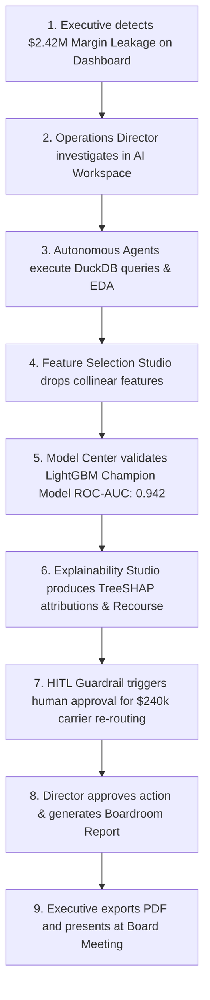

# End-to-End Enterprise User Journey & Decision Workflow

This document illustrates how different enterprise stakeholders interact with Datasphere to detect, diagnose, explain, and resolve multi-million-dollar operational problems.

---

## 1. The Decision Support Lifecycle

---

## 2. Step-by-Step Persona Walkthrough

### Phase 1: High-Level Detection (Executive Persona)
* **Persona**: Chief Operating Officer (COO) / VP of Supply Chain.
* **Screen**: [Executive Dashboard (`/workspace/dashboard`)](file:///c:/PROJECTS/Datasphere/Multi-Agent%20Data%20Analyst%20for%20Enterprise%20Decision%20Support/frontend/src/pages/DashboardPage.tsx)
* **Action**: Notices an amber warning indicator on the **SLA Delivery Rate KPI ($92.2\%$)** and sees **Identified Margin Leakage of $\$2.42\text{M}$**.
* **Transition**: Clicks *"Investigate in AI Workspace"* from the Incident Ticker.

### Phase 2: Autonomous Investigation (Data Analyst Persona)
* **Persona**: Senior Supply Chain Analyst.
* **Screen**: [AI Workspace (`/workspace/ai`)](file:///c:/PROJECTS/Datasphere/Multi-Agent%20Data%20Analyst%20for%20Enterprise%20Decision%20Support/frontend/src/pages/AIWorkspacePage.tsx)
* **Action**: Selects Golden Query #1: *"Identify the top 3 root causes of Q3 SLA delivery breaches in the Midwest region."*
* **Observation**: Watches the **LangGraph visualizer** activate nodes in real-time, observing the **Data Agent** execute DuckDB queries and the **Analysis Agent** compute correlation matrices.

### Phase 3: Statistical Validation & Modeling (Data Scientist Persona)
* **Persona**: Lead ML Engineer.
* **Screens**: [EDA Studio](file:///c:/PROJECTS/Datasphere/Multi-Agent%20Data%20Analyst%20for%20Enterprise%20Decision%20Support/frontend/src/pages/EDAPage.tsx), [Feature Selection](file:///c:/PROJECTS/Datasphere/Multi-Agent%20Data%20Analyst%20for%20Enterprise%20Decision%20Support/frontend/src/pages/FeatureSelectionPage.tsx), and [Model Registry](file:///c:/PROJECTS/Datasphere/Multi-Agent%20Data%20Analyst%20for%20Enterprise%20Decision%20Support/frontend/src/pages/ModelsPage.tsx).
* **Action**:
  1. Inspects the **Spearman Correlation Heatmap** in EDA Studio.
  2. Identifies severe collinearity on `fuel_surcharge_rate` ($\text{VIF} = 14.8$) in Feature Selection Studio and drops it.
  3. Verifies that the champion **LightGBM model** achieves **ROC-AUC: 0.942** and **F1: 0.884** with an $8.4\text{ms}$ inference latency.

### Phase 4: Regulatory Transparency & Recourse (Risk Officer Persona)
* **Persona**: Operational Risk & Compliance Officer.
* **Screen**: [Explainability Studio (`/workspace/explainability`)](file:///c:/PROJECTS/Datasphere/Multi-Agent%20Data%20Analyst%20for%20Enterprise%20Decision%20Support/frontend/src/pages/ExplainabilityPage.tsx)
* **Action**: Inspects the **TreeSHAP Beeswarm Plot** and generates **Counterfactual Recourse** for high-risk shipments, confirming that carrier re-routing delivers a **$1.85M net savings** without customer churn.

### Phase 5: Boardroom Delivery & Execution (Executive Persona)
* **Persona**: Board Member / C-Suite Executive.
* **Screen**: [Enterprise Reports Hub (`/workspace/reports`)](file:///c:/PROJECTS/Datasphere/Multi-Agent%20Data%20Analyst%20for%20Enterprise%20Decision%20Support/frontend/src/pages/ReportsPage.tsx)
* **Action**: Opens the compiled **Q3 Logistics SLA Breach Audit**, reviews the executive KPI summary, and clicks **"Export PDF"** to distribute the actionable plan across regional operating hubs.
