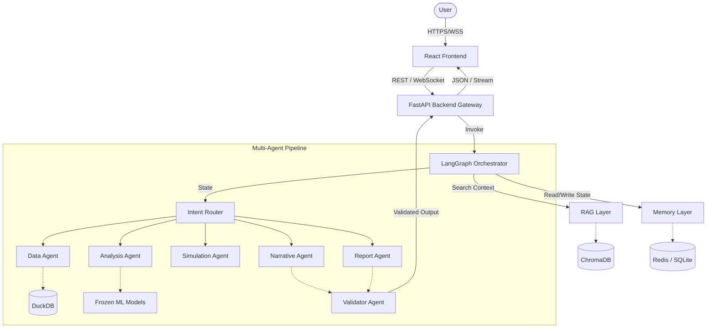

# Overall System Architecture
**Generated:** 2026-08-08 05:46:59  
**Role:** Enterprise AI Platform Architecture Team

---

## 1. High-Level Architecture Flow

The system follows a strict, unidirectional flow from user request to response, coordinated by the FastAPI gateway and LangGraph orchestrator.

## 2. Core Architectural Principles
- **Immutability of ML Artifacts:** The backend accesses Phase 1-5 artifacts in read-only mode.
- **Stateful Agents:** LangGraph manages the global state. Agents are stateless functions that operate on and mutate the LangGraph state.
- **Streaming First:** WebSockets allow token-by-token streaming of agent thoughts and RAG context to the UI.
- **Zero-Trust Validation:** The Validator Agent intercepts all outputs destined for the user to prevent hallucinations and check against policies.
